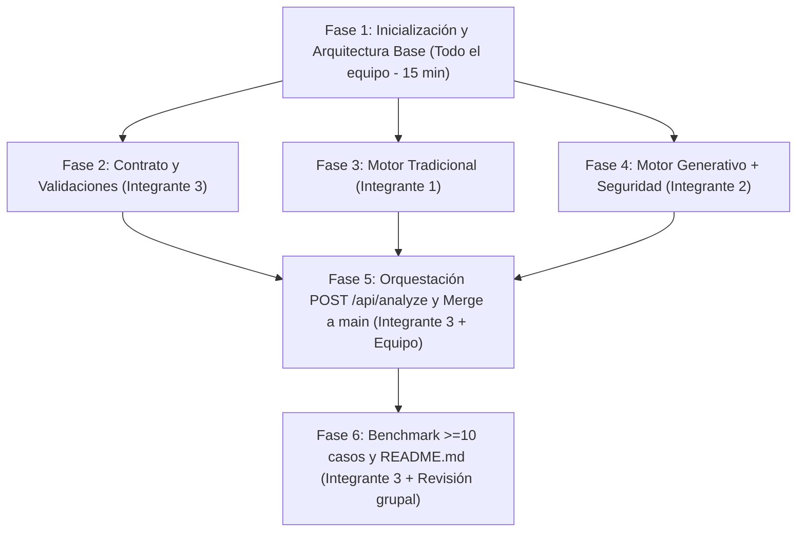

# Mapa de Fases y Ejecución en Paralelo — AI Support Engine

Este documento mapea las **6 fases de integración** del proyecto junto con la **división de responsabilidades entre los 3 integrantes**, indicando qué se hace en conjunto, qué se desarrolla en paralelo sin conflictos y en qué orden se integra todo dentro del tiempo estimado (**2–3 horas**).

---

## Diagrama de Flujo de Fases y Paralelismo

---

## Mapa Detallado por Fase

### Fase 1: Inicialización y Arquitectura Base
- **Responsable:** Todo el equipo (en la rama `main`).
- **Tiempo estimado:** ~15 minutos.
- **Objetivo:** Dejar listo el esqueleto del repositorio y acordar el stack y el contrato único para que nadie bloquee a nadie.
- **Actividades:**
  1. Elegir lenguaje (`Python + FastAPI` o `Node.js + Express`) y proveedor de IA (`Gemini`, `OpenAI` u `Ollama`).
  2. Crear estructura de carpetas (`src/engines/`, `tests/`), `.gitignore` (excluyendo `.env`, `venv/`, `node_modules/`) y archivo de dependencias (`requirements.txt` o `package.json`).
  3. Subir commit inicial a `main` y crear las 3 ramas de trabajo:
     - `feat/motor-tradicional` (Integrante 1)
     - `feat/motor-generativo` (Integrante 2)
     - `feat/api-y-pruebas` (Integrante 3)
- **Entregable de fase:** Repositorio base en `main` con ramas creadas.

---

### Fase 2: Capa de Validación y Contrato de Datos *(En paralelo)*
- **Responsable:** 👤 **Integrante 3** (`feat/api-y-pruebas`).
- **Tiempo estimado:** ~25 minutos.
- **Archivos:** `src/schemas.(py|js)`
- **Objetivo:** Garantizar que todas las entradas y salidas cumplan estrictamente el contrato del reto.
- **Actividades:**
  1. Validar `message` (string no vacío, longitud controlada) y `mode` (`"traditional"` o `"generative"`).
  2. Definir esquema de salida único (`category`, `priority`, `response`, `requiresHumanReview`, `mode`).
  3. Definir regla de seguridad transversal: si `category == "SECURITY"`, forzar `requiresHumanReview = true`.
- **Entregable de fase:** Esquemas de validación listos y probados.

---

### Fase 3: Construcción del Motor Tradicional *(En paralelo)*
- **Responsable:** 👤 **Integrante 1** (`feat/motor-tradicional`).
- **Tiempo estimado:** ~45–60 minutos.
- **Archivos:** `src/engines/traditional.(py|js)`
- **Objetivo:** Implementar el motor simbólico/reglas sin usar IA generativa.
- **Actividades:**
  1. Normalización de texto (minúsculas, limpieza, acentos).
  2. Reglas de detección para `ACCESS`, `BUG`, `FEATURE` y `SECURITY` mediante palabras clave ponderadas y expresiones regulares.
  3. Cálculo heurístico de prioridad (`LOW`, `MEDIUM`, `HIGH`, `CRITICAL`) con modificadores de urgencia/impacto.
  4. Filtro anti-manipulación básico para detectar intentos de *prompt injection* y elevar a `SECURITY` + `requiresHumanReview: true`.
  5. Catálogo de respuestas predeterminadas por categoría/prioridad.
  6. Pruebas unitarias/locales directas desde consola.
- **Entregable de fase:** Motor tradicional funcional, determinista y probado de forma aislada.

---

### Fase 4: Integración del Motor Generativo *(En paralelo)*
- **Responsable:** 👤 **Integrante 2** (`feat/motor-generativo`).
- **Tiempo estimado:** ~45–60 minutos.
- **Archivos:** `src/engines/generative.(py|js)`, `.env.example`
- **Objetivo:** Integrar un LLM real con respuestas contextualizadas, formato JSON estricto y defensas de seguridad.
- **Actividades:**
  1. Configurar lectura segura de credenciales desde variables de entorno (`.env`) y documentar `.env.example`.
  2. Diseñar *System Prompt* defensivo: delimitar el ticket del usuario (`<ticket_usuario>...</ticket_usuario>`) e instruir ignorar órdenes maliciosas dentro del mensaje.
  3. Configurar salida JSON estructurada (`Structured Outputs` / `JSON Schema`) y validar campos recibidos.
  4. Implementar post-procesamiento de seguridad (`SECURITY` -> `requiresHumanReview: true`).
  5. Manejar errores del proveedor (`try/catch`, timeouts, errores de red/cuota/parseo) sin exponer secretos.
  6. Probar el módulo directamente en consola con casos normales, de seguridad y de *prompt injection*.
- **Entregable de fase:** Motor generativo conectado, seguro y probado de forma aislada.

---

### Fase 5: Orquestación en `POST /api/analyze` e Integración Git
- **Responsable:** 👤 **Integrante 3** (endpoint) + **Todo el equipo** (Pull Requests y verificación).
- **Tiempo estimado:** ~25 minutos.
- **Archivos:** `src/app.(py|js)`
- **Objetivo:** Unir los 3 trabajos en `main` sin conflictos y verificar el endpoint completo.
- **Actividades:**
  1. Integrante 3 implementa `POST /api/analyze` conectando las validaciones (`schemas`) con ambos motores (`traditional` y `generative`).
  2. Integrantes 1, 2 y 3 suben sus ramas y hacen *merge* hacia `main` (sin conflictos al tener archivos exclusivos).
  3. Levantar el servidor local y probar `POST /api/analyze` con `curl` / Postman en ambos modos (`"traditional"` y `"generative"`), incluyendo casos inválidos (`400`/`422`).
- **Entregable de fase:** API funcional en `main` respondiendo con ambos motores bajo el mismo contrato.

---

### Fase 6: Benchmark Comparativo y Documentación Final (`README.md`)
- **Responsable:** 👤 **Integrante 3** (ejecución y redacción) + **Todo el equipo** (revisión y dominio del código).
- **Tiempo estimado:** ~30–40 minutos.
- **Archivos:** `tests/test_cases.json`, `tests/run_benchmark.(py|js)`, `README.md`
- **Objetivo:** Generar las evidencias cuantitativas exigidas por la rúbrica y preparar la entrega.
- **Actividades:**
  1. Crear el dataset con **≥10 solicitudes**: 4 normales, 4 ambiguas y ≥2 de *prompt injection* con su clasificación de referencia (*ground truth*).
  2. Ejecutar `run_benchmark` contra ambos motores y calcular el **% de clasificaciones correctas** y cumplimiento de formato.
  3. Documentar en `README.md`:
     - Instrucciones de instalación y ejecución.
     - Evidencia de ejecución de ambos motores.
     - Tabla comparativa de los ≥10 casos de prueba.
     - **Conclusión técnica breve (máximo 150 palabras)** indicando qué motor funcionó mejor y por qué.
  4. Repaso rápido en equipo (10 min) para asegurar que los 3 integrantes puedan explicar cada módulo, decisión técnica y resultado obtenido.
- **Entregable de fase:** Repositorio completo y listo para evaluación.

---

## Resumen de Tiempos y Dependencias

| Fase | Trabajo | Participantes | Duración | Bloquea a alguien |
| :--- | :--- | :--- | :---: | :---: |
| **Fase 1** | Setup inicial en `main` | Todos | ~15 min | Sí (inicio) |
| **Fase 2** | Contrato y validaciones | Integrante 3 | ~25 min | No (en paralelo) |
| **Fase 3** | Motor tradicional | Integrante 1 | ~50 min | No (en paralelo) |
| **Fase 4** | Motor generativo | Integrante 2 | ~50 min | No (en paralelo) |
| **Fase 5** | Endpoint + Merge a `main` | Integrante 3 + Todos | ~25 min | Requiere Fases 2, 3 y 4 |
| **Fase 6** | Benchmark + `README.md` | Integrante 3 + Todos | ~35 min | Requiere Fase 5 |
| **Total** | | | **~2.5 horas** | Dentro del rango (2–3h) |

